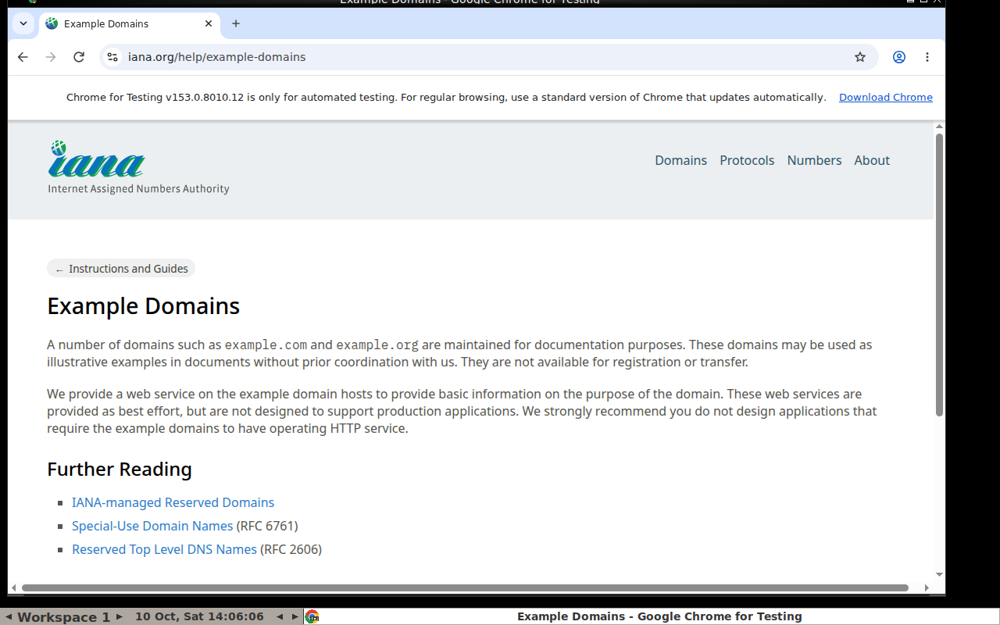

# Workshop (2–2.5 h)

**Prerequisites:** Python 3.10+, Docker, an E2B key (Hobby, free), a free OpenRouter key (`OPENROUTER_API_KEY`; free `:free` models, any OpenAI-compatible endpoint works via `LLM_BASE_URL`). `pip install -r workshop/requirements.txt`.

| # | Exercise | Time | Outcome |
|---|---|---|---|
| 1 | `ex1_e2b_code` — create a sandbox, run code, files, limits, kill it | 20 min | understanding of the sandbox lifecycle |
| 2 | `ex2_llm_loop` — `run_python` tool → E2B, the agent solves a data-analysis task | 35 min | an agent loop with isolation |
| 3 | `ex3_docker_desktop` — your own desktop: Docker+Xvfb+noVNC+Chromium, Playwright inside, watch it in the browser on :6080 | 35 min | a self-hosted remote desktop |
| 4 | `ex4_computer_use` — generic screenshot→vision LLM→function-tool action loop (click/type/key/scroll/screenshot/wait/done); backend `DESKTOP_BACKEND=docker` (ex3 container) or `e2b` (E2B Desktop) | 40 min | a computer-use agent with live view |

Bonus tasks: run ex3 with `--runtime=runsc` (gVisor); restrict egress (`--network none` / allowlist proxy); prompt-injection demo: a file with an "instruction" inside the sandbox — show that the damage stays contained.

## LLM models (OpenRouter, free tier)

Checked 2026-10-10 via `https://openrouter.ai/api/v1/models` (filter: `:free` + `tools` in `supported_parameters`). The free list changes often: run `python workshop/list_free_models.py` before the workshop. Free models are rate-limited (roughly 20 req/min and a small daily cap without credits) and may log prompts — never send secrets.

| Use | Default (env) | Alternatives |
|---|---|---|
| ex2, tool calling | [`nvidia/nemotron-3-super-120b-a12b:free`](https://openrouter.ai/nvidia/nemotron-3-super-120b-a12b:free) (`EX2_MODEL`) | [`nvidia/nemotron-3-ultra-550b-a55b:free`](https://openrouter.ai/nvidia/nemotron-3-ultra-550b-a55b:free), [`poolside/laguna-s-2.1:free`](https://openrouter.ai/poolside/laguna-s-2.1:free), [`cohere/north-mini-code:free`](https://openrouter.ai/cohere/north-mini-code:free), [`google/gemma-4-31b-it:free`](https://openrouter.ai/google/gemma-4-31b-it:free) |
| ex4, vision + tool calling | [`dots-studio/dots-3-note-preview:free`](https://openrouter.ai/dots-studio/dots-3-note-preview:free) (`EX4_MODEL`) | [`google/gemma-4-31b-it:free`](https://openrouter.ai/google/gemma-4-31b-it:free), [`google/gemma-4-26b-a4b-it:free`](https://openrouter.ai/google/gemma-4-26b-a4b-it:free), [`nvidia/nemotron-3-nano-omni-30b-a3b-reasoning:free`](https://openrouter.ai/nvidia/nemotron-3-nano-omni-30b-a3b-reasoning:free) |

Generic open models are not trained for pixel-precise clicking the way vendor computer-use models are; expect misclicks — that is a useful discussion point. Vendor-native alternatives (not used in code, mention in the talk): Anthropic's computer-use tool (`computer_toolset_20260801`, Claude) and OpenAI's computer-use tool in the Responses API — they return structured actions in a model-specific schema, while ex4 uses plain function tools so any model fits.

## Testing without an LLM

`DESKTOP_BACKEND=docker python workshop/ex4_computer_use/test_backend.py` (ex3 container named `desk` running) drives the same `execute()` the agent uses and saves `ex4-smoke.png`.

## Test run results (2026-10-10)

Run locally with OpenRouter free models. E2B was skipped (no valid key), so ex2 used `SANDBOX_BACKEND=docker` and ex4 used `DESKTOP_BACKEND=docker`.

**ex2 (`nvidia/nemotron-3-super-120b-a12b:free`, Docker sandbox).** Task: "30th Fibonacci number and the sum of primes below 10000". One `run_python` call, correct answers (832040, 5736396), about 12 s. The Docker fallback runs code in a throwaway `python:3.12-slim` container with `--network none`, a read-only rootfs, a non-root user and CPU/RAM/PID limits. That image has no numpy/scipy, so the default statistics task needs E2B or a custom image (`DOCKER_SANDBOX_IMAGE`).

**ex4 (Docker desktop, 1280x800).**

| Model | Task: open example.com, read title + first sentence | Task: click the link, report the URL | Notes |
|---|---|---|---|
| `dots-studio/dots-3-note-preview:free` | ✅ 4 steps, 17–21 s | ✅ 24 steps, ~6 min | Reliable tool calls. Navigated by typing the URL right away. Clicking took many attempts. **Chosen as the default.** |
| `nvidia/nemotron-3-nano-omni-30b-a3b-reasoning:free` | ❌ | not run | Sends 0..1 normalized coordinates as strings and keys as JSON lists (now handled). Before the fix it looped on the same click until max steps. After the fix it hit upstream "ResourceExhausted" errors and then wrote `<tool_call>` as plain text instead of structured calls, so the loop ended. |
| `google/gemma-4-31b-it:free` | ❌ 429 | — | Shared free pool was rate-limited for the whole session (3 attempts, 5 retries each). Untested; keep it as a fallback. |
| `google/gemma-4-26b-a4b-it:free` | ❌ 429 | — | Same as above. |
| `thinkingmachines/inkling:free` | ❌ 403 | — | Free tier is only for approved "agentic harnesses". Not usable from custom code. |

Takeaways for the workshop: free vision models are slow and flaky, so set `EX4_FALLBACK_MODELS`, keep tasks simple, and have the screenshot below as a backup if the demo breaks. Text answers are often correct after navigation, but pixel-precise clicking is weak. That gap is a good motivation for vendor computer-use models.

