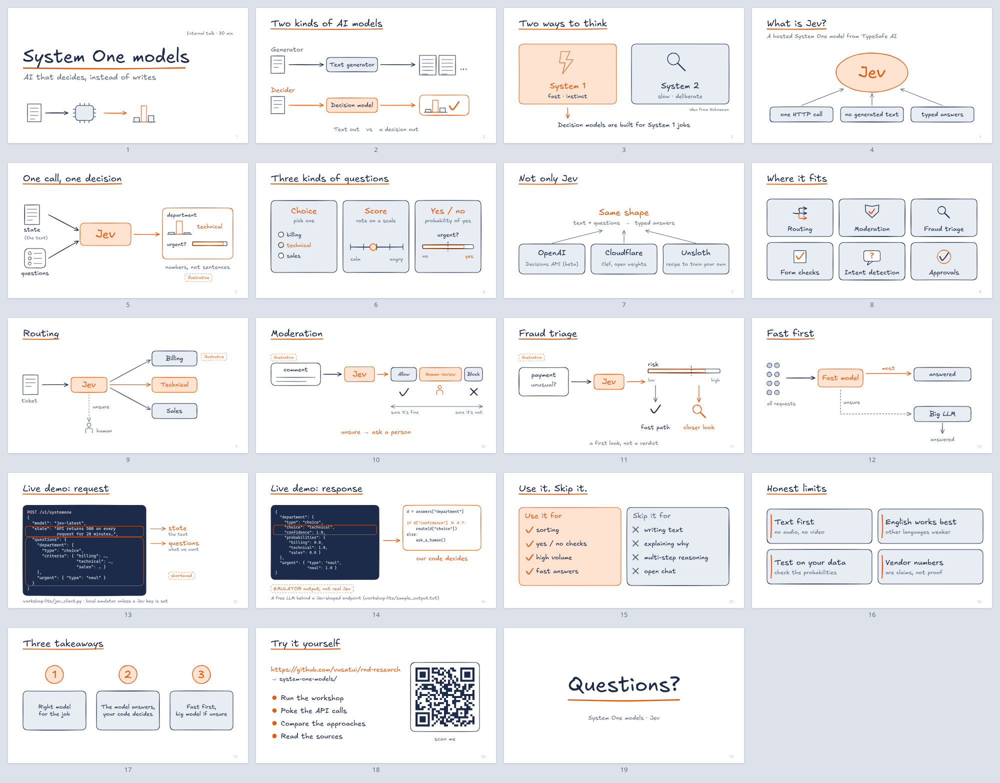

# System One: the serious deck, animated (Remotion)

The [serious variant](../serious/README.md) of the System One / Jev talk as **one interactive, animated presentation**:
the same 19 slides, in the same order, with the same facts, wording, palette (navy and slate with one orange accent on white)
and hand-drawn Excalidraw look. Every shape is drawn by [roughjs](https://roughjs.com), the renderer Excalidraw uses, and the
text is set in Excalifont. Each click plays the next build step (boxes and arrows draw on, bars grow, the request flows into Jev
and the answer flows out). Moving to the next slide plays a transition. The honest labels stay as they were: *illustrative* on
slides 5, 9, 10 and 11, *shortened* on slide 13, and *EMULATOR output, not real Jev* on slide 14. They appear together with the
slide title, so none of those slides is ever shown without its label.



Motion sample (slides 4, 5, 13 and 14): [`preview/sample-transitions.mp4`](preview/sample-transitions.mp4) · [`preview/sample-transitions.gif`](preview/sample-transitions.gif)

## Run it
```bash
cd system-one-models/presentation/remotion
npm install
npm run dev          # presenter at http://localhost:5173
```
Static build (no server-side code, no network at runtime, fonts bundled):
```bash
npm run build        # dist/ (any static host, any sub-path) + dist/standalone/index.html (one file, double-click to open)
npm run preview      # serves dist/ at http://localhost:4173
```
`dist/standalone/index.html` is a single self-contained HTML file of about 0.8 MB. It is the easiest backup to keep on a USB
stick, because it also works from `file://` with no server.

## Keys
| Key | Action |
|---|---|
| <kbd>→</kbd> <kbd>↓</kbd> <kbd>Space</kbd> <kbd>PageDown</kbd> <kbd>Enter</kbd>, mouse click | next build step, then the next slide (works with presentation clickers) |
| <kbd>←</kbd> <kbd>↑</kbd> <kbd>Backspace</kbd> <kbd>PageUp</kbd>, right-click, <kbd>Shift</kbd>+click | back one step (instant, no animation) |
| a click or key during an animation | finishes that animation immediately |
| <kbd>Home</kbd> / <kbd>End</kbd> | first / last slide |
| number then <kbd>Enter</kbd> (e.g. <kbd>1</kbd><kbd>3</kbd><kbd>Enter</kbd>) | jump to that slide |
| <kbd>f</kbd> | fullscreen |
| <kbd>n</kbd> | speaker notes panel: the read-aloud script for the current slide, its time budget, the step, a talk timer and the next slide. On slide 19 the panel also shows the Q&A. |
| <kbd>+</kbd> / <kbd>−</kbd>, <kbd>t</kbd> | notes text size, restart the timer |
| <kbd>?</kbd> | key help |

The slide counter and the step dots sit in the bottom-left corner, and the key hint fades out after a few seconds. The URL hash
tracks the position (`#13.2` = slide 13, step 2), so a reload keeps your place and links can point at a step. `?notes` opens with
the notes panel showing.

The talk has 62 clicks in total: 18 slide changes and 44 build steps.

## How it works
```
src/deck/theme.ts      palette, sizes, fonts (the same constants as serious/tools/build_deck.py)
src/deck/shapes.tsx    rough primitives: Rect, Ellipse, Line, Arrow, Txt with draw-on, fade and wipe animations
src/deck/parts.tsx     doodles from build_deck.py: Doc, Chip, Bars, Gauge, Check, Cross, Bolt, Shield, CodePanel, Tag, Title, ...
src/deck/slides.tsx    the 19 slides and their build steps
src/deck/timeline.ts   frame maths: where each slide starts and where each step ends
src/deck/Deck.tsx      the Remotion composition (TransitionSeries with fade and slide transitions)
src/presenter/         the presenter: @remotion/player plus a slide/step state machine, keys, notes panel
src/remotion/          Remotion Studio and CLI entry (compositions Deck, Presenter, Sample)
src/notes.json         generated from ../serious/speaker-notes.md   (npm run sync)
src/assets/            fonts (Excalifont, Cascadia Code, an arrows-only subset of Liberation Sans) and qr.png
scripts/               sync-assets.mjs, make_fonts.py, verify.mjs, make-gif.mjs
```
Slides use the 1600×900 coordinates of the Excalidraw deck, and the layout is scaled into the 1920×1080 composition. The
presenter plays the composition with no holds and pauses at the last frame of each step. The video compositions use the same
timeline but hold every step for a moment, so the presenter and a rendered MP4 always show exactly the same frames.

## Edit
- **Text or layout:** edit the slide in `src/deck/slides.tsx`. Coordinates are the ones in `build_deck.py`.
- **Build steps:** every slide has `steps: [entry, step1, step2, ...]`, the length of each step in frames at 30 fps. An element
  appears in step *k* with `p={t.p(k, delay, duration)}`. Keep `delay + duration` within that step's length.
- **Transitions:** set `enter: "fade" | "slide"` on a slide in the `SLIDES` list.
- **Speaker notes:** edit `../serious/speaker-notes.md`, then run `npm run sync`. The same command copies `../serious/qr.png` again.
- **Fonts:** `python3 scripts/make_fonts.py` rebuilds `src/assets/fonts/` from the Excalidraw package in `../tools/node_modules`.
- **Remotion Studio:** run `npm run studio` to scrub the timeline and see every frame (compositions `Deck`, `Presenter`, `Sample`).

## Export
```bash
npm run render          # out/deck.mp4: the whole deck played back automatically, each step held for 1.5 s (about 3 min 20 s)
npm run render:sample   # preview/sample-transitions.mp4 + .gif: slides 4, 5, 13 and 14
npm run render:presenter  # out/presenter-timeline.mp4: the exact presenter timeline, with no holds
```
On the first render, Remotion downloads its headless Chrome. To use a Chrome you already have instead, set `REMOTION_CHROME=/path/to/chrome`.

## Verify
```bash
npm run dev &        # or: npm run build && npm run preview
npm run verify       # or: npm run verify -- http://localhost:4173/   or  file:///…/dist/standalone/index.html
```
The check uses headless Chrome (`CHROME_PATH`, default `/usr/bin/google-chrome`). It takes a screenshot of every build step of
every slide into `verify/shots/` (git-ignored), and saves three mid-animation frames. It then clicks through the opening
slides and checks that each animated step stops exactly on its target frame. Last, it rebuilds `contact-sheet.png` from the
final state of every slide.

## Notes
- Content source of truth: [`../serious/`](../serious/). Nothing on the slides was added or reworded.
- Fonts are bundled from the Excalidraw package: Excalifont, Cascadia Code, and Liberation Sans for the → glyph, which
  Excalifont lacks. All three are under the SIL Open Font License 1.1. No font or other file is fetched from the network at runtime.
- `node_modules/`, `dist/`, `out/` and `verify/shots/` are git-ignored.
